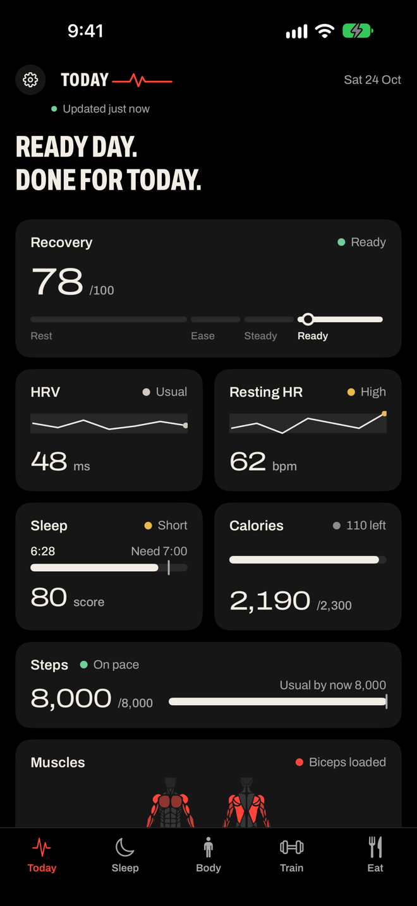
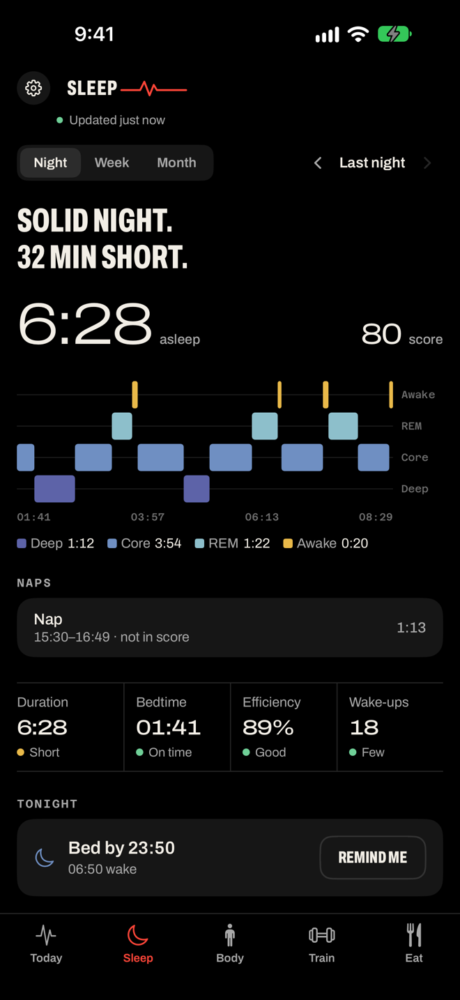
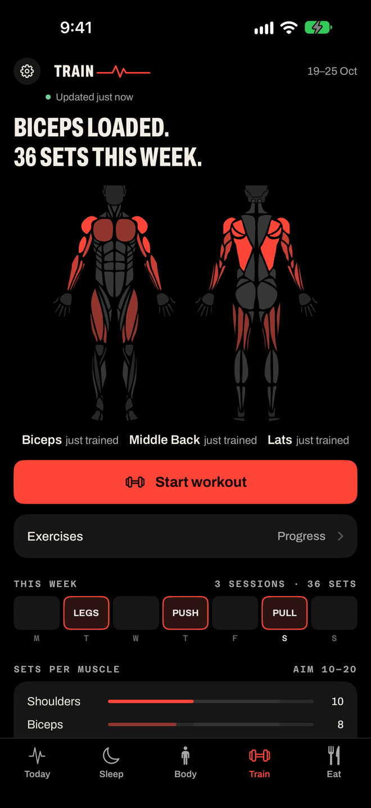
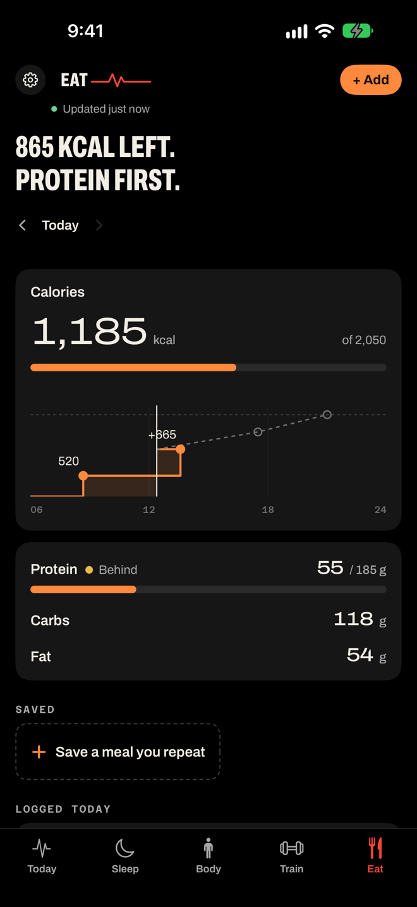
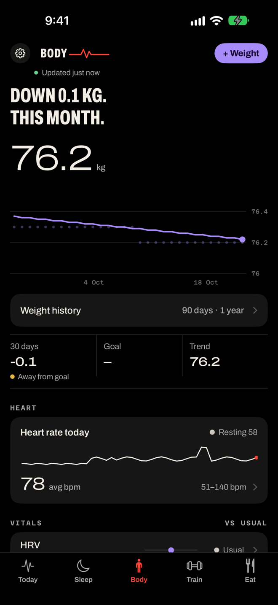
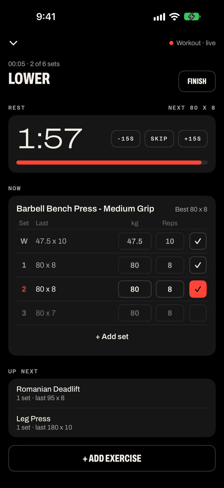
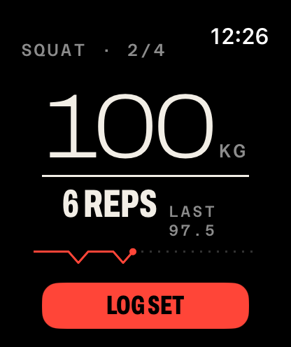
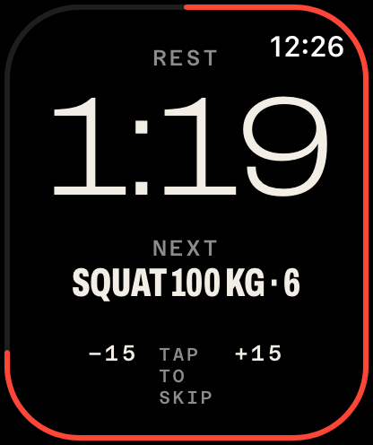

# Vitalis

A self-hosted health app for one person: an iPhone and Apple Watch app, plus a server that your agents can talk to over MCP. Vitalis reads Apple Health, scores your sleep and recovery against your own normal, and keeps the two logs Apple Health doesn't do well: strength training and food.

Your data lives on your server. One instance serves one person.

<p align="center">
  
  
  
  
  
</p>
<p align="center">
  
  
  
</p>

<sub>iPhone and Watch simulators running the Debug build in demo mode (`-VitalisDemo`), with bundled fixture data.</sub>

## What it does

- **Sleep.** Each night is scored on duration against your need, bedtime consistency, efficiency and wake-ups. You see the stages across the night, and week and month views of hours and scores. Naps are kept apart from the night, never inflate it, and shorten the next night's sleep need.
- **Recovery.** A daily score from HRV, resting heart rate and sleep, each against your own 60-day range, with one plain headline for the day ("Steady day. Train normally.").
- **Training.** Log sets on the iPhone or the Watch, including both at once in one workout. Muscle load shows on a body map, from grey (no load) to red (just trained). Splits come from your own settings and history; the app never assumes a schedule. A catalogue of about 750 exercises ships with it.
- **Food.** Search, scan a barcode (Open Food Facts), describe a meal, or photograph a label. Log part of a pack, then edit or delete it later. A calorie target follows your goal, your weight trend and what your Watch says you burn.
- **Body.** Your latest weigh-in, the weight trend, and vitals such as HRV, resting HR, SpO₂ and breathing against their usual range.
- **For agents.** 34 MCP tools read and write the same data the app shows (a test fails if an app route has no tool): the day's brief, sleep, scores, metrics, workouts, exercise history, food, saved meals, targets and freshness, plus writing sets, workouts, exercises, food, saved meals, weight, targets and splits. Anything the app can change, an agent can too. A missing day is reported as missing, never as zero.

## Repository

| Path | What |
|---|---|
| `app/` | The server: Node 22, TypeScript, Hono, `node:sqlite`, the official MCP TypeScript SDK. It serves the app's `/v2` API, `/mcp` and `/health`, and still accepts [Health Auto Export](https://apps.apple.com/app/id1115567069) pushes on `/ingest`. |
| `apple/` | The SwiftUI iPhone app, Watch app, widgets and Siri shortcuts. It syncs HealthKit to the server and works offline from a cache. See [`apple/README.md`](apple/README.md). |
| `spec/` | The spec of record: product, server API, scoring, data model, iOS, Watch and design system. |
| `docs/` | Self-hosting ([`deploy.md`](docs/deploy.md)), the legacy ingest and MCP contract ([`api.md`](docs/api.md)), and notes on native sync and storage. |
| `deploy/` | Docker Compose: a read-only container on a loopback port with one data directory. |

## Quickstart (server, local)

```sh
cd app && npm ci && npm run build && npm test
VITALIS_ROOT=../.data VITALIS_TZ=Asia/Kolkata npm start            # http://127.0.0.1:8350
VITALIS_ROOT=../.data npm run cli -- token create iphone --scope write
```

Paste the token into the app's setup screen. To build the app, see [`apple/README.md`](apple/README.md). To run it on your own server, see [`docs/deploy.md`](docs/deploy.md).

## Credits

Exercise catalogue from [free-exercise-db](https://github.com/yuhonas/free-exercise-db) (Unlicense). Muscle map paths from [react-native-body-highlighter](https://github.com/HichamELBSI/react-native-body-highlighter) (MIT). Fonts: Archivo and Azeret Mono (SIL OFL 1.1). Food data from [Open Food Facts](https://world.openfoodfacts.org) (ODbL).

## License

[MIT](LICENSE)
